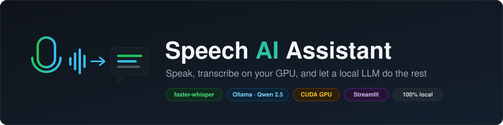
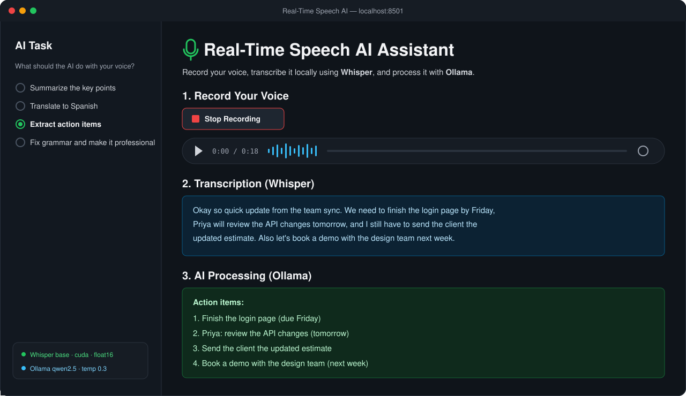
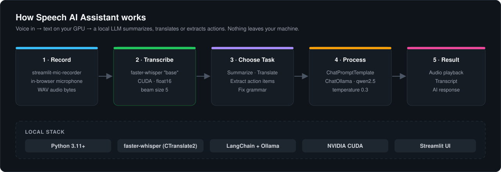

<p align="center">
  
</p>

<p align="center">
  
  
  
  
  
</p>

\# 🎙️ Real-Time Speech AI Assistant


A real-time, multimodal AI application that captures voice audio, transcribes it locally using GPU-accelerated Whisper, and processes the text with a local LLM (Ollama).

<p align="center">
  
  <br><sub>App preview: a voice note turned into action items, fully on your own machine</sub>
</p>


\## ✨ Key Features

\- \*\*Local Speech-to-Text:\*\* Uses `faster-whisper` running on NVIDIA GPU (CUDA) for lightning-fast, private audio transcription.

\- \*\*Local LLM Processing:\*\* Chains the transcription directly into Ollama (Qwen 2.5) to summarize, translate, or extract action items from voice notes.

\- \*\*Zero API Costs:\*\* 100% local execution. No data leaves your machine, and no external API keys are required.

\- \*\*Interactive UI:\*\* Built with Streamlit and `streamlit-mic-recorder` for seamless in-browser audio capture.


## ⚙️ How It Works

<p align="center">
  
</p>


\## 🛠️ Tech Stack

\- \*\*Python 3.11+\*\*

\- \*\*Faster-Whisper\*\* (High-performance local ASR)

\- \*\*Ollama\*\* (Local LLM inference)

\- \*\*Streamlit\*\* (Interactive Web UI)

\- \*\*Pydub\*\* (Audio processing)


\## 🚀 Getting Started


\### Prerequisites

1\. Install \[Ollama](https://ollama.com/download) on your machine.

2\. Pull the required local model:

&nbsp;  ```bash

&nbsp;  ollama pull qwen2.5

